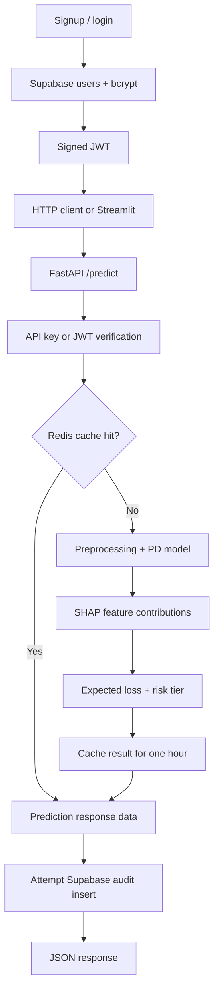

# SBA Loan Risk Engine

[](https://github.com/dhruvbadhe/sba-loan-risk-engine/actions/workflows/ci.yml)


A FastAPI service that scores SBA loan applications with a bundled scikit-learn
HistGradientBoosting model. It returns a default probability, expected-loss
calculation, risk tier, underwriting action, and SHAP feature contributions.
A separate Streamlit dashboard calls the API over HTTP.

The test and coverage badges are snapshots from 16 October 2026; CI is a live
workflow badge. Upgrade work is tracked in [the plan](docs/UPGRADE_PLAN.md).
S1–S13 and continuation tasks P1–P9 are merged. See the
[upgrade report](docs/UPGRADE_REPORT.md) for PRs, coverage scope, and remaining
manual security steps. Hosted deployment status must be verified separately from
test results.

## Architecture



Authentication runs before inference. A valid `X-API-KEY` or bearer JWT grants
access to `/predict`; missing, invalid, or expired credentials return 401.
`/health`, `/docs`, and `/metrics` are public.

Redis caches prediction and explanation data, keyed by a hash of the sorted
input including derived features. A cache hit still attempts an audit insert.
Redis failure falls back to inference; Supabase audit failure is logged and does
not fail the prediction. Without a configured Supabase client, login and signup
return 503 and audit inserts are disabled.

## Quick start: API and Redis

Install Docker with Compose and start its engine. Then:

```bash
git clone https://github.com/dhruvbadhe/sba-loan-risk-engine.git
cd sba-loan-risk-engine
docker compose up --build
```

Open [local API docs](http://localhost:8000/docs). In another terminal:

```bash
curl --fail http://localhost:8000/health
# {"status":"healthy","version":"1.0.0"}
```

No `.env` or cloud account is required for local API-key predictions. The API
binds to `127.0.0.1:8000`; Redis has no host port. With no environment overrides,
the local API key is the development placeholder `local-compose-api-key`.
Compose reads an existing `.env` if present, so use your configured API key when
you have overridden it. Stop the stack with `docker compose down`.
See [Compose setup](docs/COMPOSE_SETUP.md) for details.

## Python development

Python 3.10 matches the container and CI runtime. Create a virtual environment
from the repository root:

```bash
python3.10 -m venv venv
source venv/bin/activate
python -m pip install -r requirements-test.txt
```

For development hooks, run `python -m pip install -r requirements-dev.txt`, then
`pre-commit install` once per clone. Check everything with
`pre-commit run --all-files`. Hooks run Ruff lint/format, end-of-file and trailing
whitespace fixes, and added-file size checks. Ruff matches CI's pinned version;
notebooks and `src/clean.py`, `src/features.py`, and `src/pipeline.py` are excluded
from automatic hooks to preserve the protected research sources. The separate
formatting PR prepared the other Python files. The existing model is unaffected;
the size hook rejects newly added files above its default 500 KB limit.

To start the API without Docker, set your local configuration and run:

```bash
export ENV=development
export API_KEY=your-local-api-key
export JWT_SECRET_KEY=your-local-jwt-signing-key
python -m uvicorn app.main:app --reload
```

Those strings are placeholders for local development. Redis is optional for this
mode; the API continues without caching if `localhost:6379` is unavailable. The
model must exist at `app/models/best_hgb_pipeline.pkl` or at `MODEL_PATH`.
This is the only stored model artifact. The root `models` directory is a symlink
to `app/models` so historical notebook paths still work. Git checkouts must
support symlinks to use those legacy paths. Docker and Compose explicitly use
`/code/app/models/best_hgb_pipeline.pkl` and copy only the canonical artifact.

The optional dashboard can be started separately:

```bash
python -m streamlit run app/streamlit_app.py
```

It opens at [localhost:8501](http://localhost:8501). Streamlit reads `API_BASE_URL`
from its process environment, defaulting to `https://sba-loan-risk-api.onrender.com`.
To use your local API, start it with:

```bash
API_BASE_URL=http://127.0.0.1:8000 python -m streamlit run app/streamlit_app.py
```

Use a base URL without a trailing slash. Streamlit is not included in Compose.
This setting belongs to the Streamlit process, not the FastAPI settings or `.env`
loader; export it before starting the UI.

## Environment variables

The native API reads process environment variables and an optional root `.env`.
Keep real credentials outside Git. Production must explicitly set
`ENV=production`, `API_KEY`, and `JWT_SECRET_KEY`.

| Variable | Purpose and default | Required? |
| --- | --- | --- |
| `ENV` | `development`; set exactly `production` to enable production secret validation | Production |
| `API_KEY` | Shared key for `X-API-KEY`; native development default is `dev-key-change-in-production` | Private non-default value in production |
| `JWT_SECRET_KEY` | JWT signing key; native development default is `super-secret-key-change-for-production` | Separate private non-default value in production |
| `JWT_ALGORITHM` | JWT algorithm, `HS256` | No |
| `ACCESS_TOKEN_EXPIRE_MINUTES` | Token lifetime, `60` | No |
| `API_BASE_URL` | Streamlit backend URL, defaults to `https://sba-loan-risk-api.onrender.com` | UI only; optional process environment variable |
| `CORS_ORIGINS` | Comma-separated browser origins; defaults to localhost and 127.0.0.1 on ports 8501 and 8000 | Set explicit HTTPS UI origins for production browser access; `*` is rejected |
| `REDIS_URL` | Native default `redis://localhost:6379/0`; Compose uses `redis://redis:6379/0` | No |
| `SUPABASE_URL` | Supabase project URL, empty by default | Login, signup, audit logging |
| `SUPABASE_KEY` | Credential authorized for the required Supabase table operations, empty by default | Login, signup, audit logging |
| `MODEL_PATH` | Bundled `app/models/best_hgb_pipeline.pkl` | Override only for another model path |
| `APP_NAME` | API title, `SBA Loan Risk Assessment API` | No |
| `DEBUG` | Settings field, defaults to `false`; currently does not configure FastAPI debug mode | No |

Compose fixes `ENV=development` and `DEBUG=false`; it forwards API/JWT and Supabase
values with local fallbacks. Other native settings are not forwarded unless added
to the Compose configuration. Production validation rejects missing, default,
empty, and whitespace-only API/JWT secrets before startup completes.

Set `CORS_ORIGINS` to exact origins, including scheme and port, without trailing
slashes. For example: `https://dashboard.example.com,http://localhost:8501`.
An empty value disables browser cross-origin access. CORS is a browser rule,
not authentication; server-to-server Streamlit requests still need API credentials
but do not need a CORS entry. In Render, set this under **Environment → Edit →
Add Environment Variable**, then save and deploy if a browser UI needs access.

Supabase must already have tables accessible to the supplied credential:
`users` with `username` and `password_hash`, and `predictions` with `username`,
`loan_amount`, `term_months`, `interest_rate`, `probability_of_default`,
`expected_loss`, and `risk_tier`. Table creation is not included. Use a server-only
backend secret key and follow [Supabase security steps](docs/SUPABASE_SECURITY.md)
to enable RLS, revoke browser access, and rotate the old committed key.

## API examples

### Predict with an API key

With the default Compose development configuration:

```bash
curl --fail-with-body http://localhost:8000/predict \
  -H 'Content-Type: application/json' \
  -H 'X-API-KEY: local-compose-api-key' \
  -d '{
    "grossapproval": 250000,
    "sbaguaranteedapproval": 187500,
    "terminmonths": 120,
    "initialinterestrate": 7.5,
    "jobssupported": 10,
    "bank_prior_def_rate": 0.08,
    "bank_prior_loans": 500,
    "sector_historical_default_rate": 0.087,
    "naics_sector": "72",
    "businesstype": "CORPORATION",
    "business_age_group": "Existing",
    "bank_experience_tier": "High",
    "revolverstatus": 0,
    "is_same_state_bank": 1,
    "is_variable_rate": 1,
    "is_franchise": 0,
    "collateralind": 1
  }'
```

The response contains `probability_of_default`, `loss_given_default`,
`exposure_at_default`, `expected_loss`, `risk_tier`, `underwriting_action`,
`shap_base_value`, `shap_values`, and `processed_features`. Prediction values
come from the bundled model; the API-test doubles are not example model metrics.

### Signup and JWT login

With Supabase configured, register using JSON and log in using form data. Replace
the sample credentials with your own local test account:

```bash
curl --fail-with-body http://localhost:8000/signup \
  -H 'Content-Type: application/json' \
  -d '{"username":"example-user","password":"replace-with-your-test-password"}'

curl --fail-with-body http://localhost:8000/login \
  --data-urlencode 'username=example-user' \
  --data-urlencode 'password=replace-with-your-test-password'
```

Login returns `access_token` and `token_type`. To use it for prediction, replace
the `X-API-KEY` header in the prediction example with
`Authorization: Bearer <access_token>`. Passwords are bcrypt hashes in Supabase;
the service issues signed JWTs with an expiry. No fallback login account exists.

| Endpoint | Authentication | Result |
| --- | --- | --- |
| `GET /health` | Public | Status and version |
| `GET /docs` | Public | Interactive OpenAPI documentation |
| `GET /metrics` | Public | Prometheus HTTP metrics |
| `POST /signup` | Public; configured database required | 201 on successful registration |
| `POST /login` | Form credentials; configured database required | JWT on successful login |
| `POST /predict` | API key or JWT | Prediction, loss estimate, tier, explanation |

For `/predict`, invalid credentials return 401 and invalid request structure or
field types return 422. Amount/rate domain bounds are not yet enforced; use
positive gross approval and sensible loan inputs. Do not submit a zero gross
approval to the serving endpoint: its direct LGD division differs from the
zero-safe, clipped helper in `src/expected_loss.py`.

## Risk calculation and design decisions

The serving calculation is `EL = PD × LGD × EAD`, with
`LGD = (grossapproval − sbaguaranteedapproval) / grossapproval` and
`EAD = grossapproval`. It treats the unguaranteed share as loss on default and
assumes zero recovery on that share. This is a modeling assumption, not a claim
of regulatory compliance.

| PD interval | Risk tier | API action |
| --- | --- | --- |
| Below 10% | Tier 1 | Auto Approve |
| 10% to below 25% | Tier 2 | Manual Review |
| 25% to below 40% | Tier 3 | Senior Review |
| 40% and above | Tier 4 | Recommend Denial |

- **Separate UI and inference:** Streamlit sends HTTP requests; FastAPI owns model
  loading, preprocessing, predictions, and explanation data.
- **Optional external services:** Redis and audit logging are best effort. Auth
  fails closed when credentials are invalid or the user database is unconfigured.
- **Deterministic caching:** Repeated inputs share a one-hour cache entry. The
  current key does not include a model version; clear the cache when changing the
  model to avoid serving old results.
- **Docker stages:** Dependencies are installed in a builder stage; the runtime
  stage excludes the compiler toolchain.
- **Offline tests:** External services and model/explainer behavior are mocked in
  API tests. Unit tests exercise the actual loss and tier helpers. CI additionally
  starts the real container with the bundled model.

The SHAP explainer is built lazily once per API process and reused on uncached
requests; a lock prevents duplicate initialization by concurrent callers.
Each worker keeps its own model and explainer. The model is immutable for that
process; restart workers and clear Redis when deploying a different model.
Current implementation limits include import-time model loading and the absence
of measured latency numbers. These are tracked or deferred in the
upgrade plan. The research pipeline in `src/pipeline.py` defines XGBoost and uses
a different feature schema from the bundled HistGradientBoosting serving model;
it is not the API's runtime inference path.

## Tests and coverage

```bash
python -m ruff check --config ruff.toml app src tests
python -m pytest -q --cov --cov-report=term-missing --cov-report=xml
```

Verified on 16 October 2026: **91 tests pass with 57.60% statement coverage**
(360/625 statements) across `app/` and `src/`, **excluding `app/streamlit_app.py`**
in coverage configuration. Backend `app/` coverage is **100.00%** (324/324).
Streamlit has focused backend-URL/sign-in smoke tests; comprehensive interactive
prediction, chart, and session testing is outside this backend coverage scope.
Research/training modules remain included in the total and are largely untested.
Startup-test subprocesses are measured too. Coverage measures statements, not all
branches or correctness.

Before P8's added tests, the same scope measured **48.16% overall** (301/625) and
**81.79% backend app coverage** (265/324), with 59 tests. The 32 added tests include
real bcrypt verification, cache/error paths, risk boundaries, concurrent SHAP
initialization/retry, and an offline request with the bundled model and real SHAP
explainer; external Supabase/Redis calls remain mocked.

Tests use an empty working directory for settings and forbid network access;
Supabase and Redis are mocked. Most API tests also mock model/SHAP behavior; one
integration test uses the real bundled model and explainer. They run
without `.env`. Pydantic deprecations are treated as test errors; the signup
schema uses supported `examples` metadata. Local Python 3.9.6 still reports
third-party Matplotlib/Pyparsing and urllib3/LibreSSL warnings, which are not
suppressed by the test configuration. Generated `.coverage` and `coverage.xml`
files are ignored; CI uploads the XML as `coverage-report`.

## CI and deployment

[CI](.github/workflows/ci.yml) runs on every PR and push to `main`, using Python
3.10. The `lint-test-build` job runs:

1. Ruff lint.
2. Pytest with coverage.
3. Docker Compose image build.
4. API and Redis startup, health checks, then container teardown.

Failures stop later checks; teardown and report upload still run. Ruff uses
`E4`, `E7`, `E9`, and `F`, with explicit exceptions for existing lint issues in
four files. Actions and Ruff are pinned in the workflow/dependencies.

GitHub branch protection requires an up-to-date PR and passing `lint-test-build`,
including for administrators. Render is configured to automatically deploy `main`
after CI checks pass. Manual deployments are separate triggers. The Blueprint
declares the same gate; the owner's saved dashboard settings were confirmed.

See the exact [branch-protection steps](docs/BRANCH_PROTECTION.md),
[production environment checks](docs/RENDER_ENV_SETUP.md), and
[Render deployment setup](docs/RENDER_CD_SETUP.md). The first production deploy
of the upgrade stack must be checked after merge; passing PR CI alone does not
prove that the hosted service runs those changes.

## Repository map

| Path | Responsibility |
| --- | --- |
| `app/api/` | Auth and prediction routes; Pydantic request/response models |
| `app/core/` | Settings, JWT/password helpers, authentication dependency |
| `app/cache/` | Redis client and fallback behavior |
| `app/middleware/` | Request latency logging |
| `app/models/` | Bundled serving model |
| `app/streamlit_app.py` | Separate dashboard |
| `src/` | Research cleaning, features, training, evaluation, loss and tier helpers |
| `tests/` | Auth regressions, API requests, startup validation, loss/tier unit tests |
| `compose.yaml` | Local API and Redis services |
| `docs/UPGRADE_PLAN.md` | Upgrade scope, status, and done-checks |

Hosted links: [Streamlit dashboard](https://sba-loan-risk-engine-aszwcpfzqmdffrrr4uhvvr.streamlit.app/)
· [Render API docs](https://sba-loan-risk-api.onrender.com/docs).
