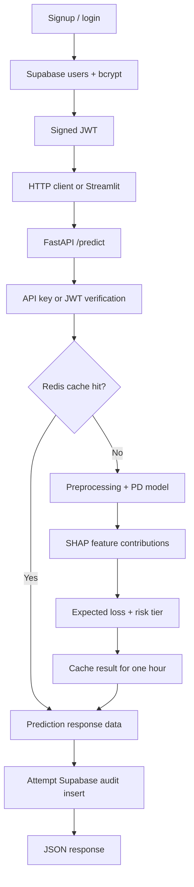

# SBA Loan Risk Engine — Complete Project Guide

**Project:** `dhruvbadhe/sba-loan-risk-engine`  
**Guide prepared:** 15 October 2026  
**Verified implementation:** merge commit `6eaeb60b31dceb4a5a29e181a099bc33f85c80b7`

This guide consolidates the project purpose, data and ML work, serving system,
authentication, caching, explanations, API contract, setup, tests, deployment,
upgrade history, and known limitations. It is intended for onboarding, project
review, maintenance, and interview preparation.

It describes a portfolio credit-risk application. Its tier labels are software
outputs; the project does not establish regulatory compliance or suitability for
automated real-world lending decisions.

## Contents

1. [Project summary](#project-summary)
2. [Data and machine learning](#data-and-machine-learning)
3. [Architecture](#architecture)
4. [Quick start: API and Redis](#quick-start-api-and-redis)
5. [Python development](#python-development)
6. [Environment variables](#environment-variables)
7. [API examples](#api-examples)
8. [Risk calculation and design decisions](#risk-calculation-and-design-decisions)
9. [Tests and coverage](#tests-and-coverage)
10. [CI and deployment](#ci-and-deployment)
11. [Repository map](#repository-map)
12. [Detailed API contract](#detailed-api-contract)
13. [Authentication, caching, and audit internals](#authentication-caching-and-audit-internals)
14. [Verified upgrade and deployment record](#verified-upgrade-and-deployment-record)
15. [Operations and troubleshooting](#operations-and-troubleshooting)
16. [Known limitations and deferred work](#known-limitations-and-deferred-work)
17. [Interview preparation](#interview-preparation)
18. [Sources and conflicting historical claims](#sources-and-conflicting-historical-claims)

## Project summary

The application accepts an SBA loan application and returns:

- **PD:** the model's probability of the default class.
- **LGD:** a proxy based on the loan's unguaranteed share.
- **EAD:** gross approved amount.
- **EL:** `PD × LGD × EAD`, expressed in dollars.
- One of four risk tiers and an associated underwriting action label.
- SHAP base value, per-feature contributions, and processed feature values.

A FastAPI backend owns model inference. A Streamlit frontend manages login,
collects loan inputs, calls the API, and displays results, a SHAP waterfall, and
guarantee scenarios. Redis can reuse computations; Supabase stores user password
hashes and accepts prediction audit inserts. Prometheus and request logs provide
basic service observations.

| Component | Technology | Responsibility |
| --- | --- | --- |
| API | FastAPI, Uvicorn, Pydantic | Routes, validation, JSON responses |
| Authentication | PyJWT, Passlib, bcrypt | Signed tokens and password verification |
| Serving model | scikit-learn 1.6.1, Joblib | Bundled preprocessing/classifier pipeline |
| Explainability | SHAP | Tree-model contributions |
| Data calculations | pandas, NumPy | Input frame, derived features, loss/tier helpers |
| UI | Streamlit, Requests, Matplotlib | HTTP client and visualization |
| Cache | Redis | One-hour prediction/explanation cache |
| User/audit storage | Supabase client | `users` and `predictions` tables |
| Monitoring | Prometheus FastAPI Instrumentator | HTTP metrics |
| Packaging | Multi-stage Docker, Compose | Runtime image and local services |
| Verification | pytest, pytest-cov, Ruff, GitHub Actions | Regression tests, coverage, lint, container startup |
| Hosting | Render API, Streamlit Cloud frontend | Hosted services |

## Data and machine learning

### Data lineage and counts

The research notebooks are the strongest available source for what was actually
coded and what results were saved. They were inspected for this guide, not rerun.
Raw files and processed datasets are not bundled as a reproducible training
release, so the following are **saved notebook results**, not fresh measurements.

| Stage | Saved result | Source |
| --- | --- | --- |
| Input to target filtering | 1,947,098 rows | `SBA_DataCleaning.ipynb` |
| Rows after retaining selected outcome labels | 1,414,014 | `SBA_DataCleaning.ipynb` |
| Rows dropped by outcome filtering | 533,084 | `SBA_DataCleaning.ipynb` |
| Default-class count after outcome filtering | 151,966 | `SBA_DataCleaning.ipynb` |
| Non-default count after outcome filtering | 1,262,048 | `SBA_DataCleaning.ipynb` |
| Default fraction after outcome filtering | 10.75% | `SBA_DataCleaning.ipynb` |
| Modern subset, approval fiscal year ≥ 2010 | 515,250 rows; 8.70% default fraction | `SBA_DataCleaning.ipynb` |
| Feature frame before extra filters | 515,250 rows × 56 columns | `Feature_Engineering_SBA.ipynb` |
| Feature frame after positive term/rate filters | 514,983 rows × 56 columns | `Feature_Engineering_SBA.ipynb` |
| Test-set classification-report support | 58,705 rows: 49,375 non-default, 9,330 default | `SBA_MODELING.ipynb` |

The notebook workflow references processed files such as
`data/processed/cleaned.parquet` and `data/processed/features.parquet`. The original
project proposal describes a different 899,164-row historical dataset. Do not
combine those dataset sizes into a single training claim.

### Target labels

The cleaning notebook explicitly uses:

```python
default_statuses = ['CHGOFF', 'LIQUID', 'SOLDCO']
non_default_statuses = ['P I F', 'CLSLN', 'SOLDNC', 'PURCH(NOT C/O)']
```

Only those labels are retained, and membership in `default_statuses` becomes
`target=1`. `CANCLD` is not included in that notebook target definition. These
choices describe the notebook implementation; they are not independently
validated business interpretations of all status codes.

The separate `src/clean.py` helper uses the older `MIS_Status` schema, retaining
`CHGOFF` and paid-in-full spellings. It is not interchangeable with the notebook's
`loanstatus` processing.

### Cleaning and exploratory work

The older portfolio report attributes the modern-data filter to systematic
missingness in `initialinterestrate` in earlier decades. The notebook confirms
the fiscal-year filter; this guide does not re-estimate missingness percentages.
The feature notebook additionally:

- Keeps rows with `terminmonths > 0` and `initialinterestrate > 0`.
- Caps `jobssupported` at 500.
- Orders rows by `approvaldate` before calculating historical aggregates.

EDA notebooks explore year, industry, guarantee, loan-size, and borrower patterns.
The portfolio report gives numerical associations for guarantee ratios and
macroeconomic periods. These should be reproduced before reuse as measured
claims. Observational associations do not establish that guarantee policy or
interest-rate changes caused a particular default outcome.

### Serving feature groups

The API receives 17 fields and derives two more before passing a pandas frame to
the serialized pipeline:

| Group | Features |
| --- | --- |
| Numeric inputs | `grossapproval`, `sbaguaranteedapproval`, `terminmonths`, `initialinterestrate`, `jobssupported`, `bank_prior_def_rate`, `bank_prior_loans`, `sector_historical_default_rate` |
| Derived numeric | `unguaranteed_exposure = grossapproval - sbaguaranteedapproval`; `log_gross_approval = log1p(grossapproval)` |
| Categorical | `naics_sector`, `businesstype`, `business_age_group`, `bank_experience_tier` |
| Binary-style inputs | `revolverstatus`, `is_same_state_bank`, `is_variable_rate`, `is_franchise`, `collateralind` |

The modeling notebook applies median imputation and scaling to numeric features,
constant imputation and dense one-hot encoding with unknown-category handling to
categoricals, and passthrough to binary features. The API uses the serialized
preprocessor; it does not rebuild the training pipeline per request.

### Historical aggregates and leakage limits

`Feature_Engineering_SBA.ipynb` sorts by approval date and uses group cumulative
default counts minus the current row's target, divided by prior row counts, for
bank and sector rates. A bank's first row receives a missing bank rate. The sector
rate uses a denominator clipped to at least one.

This excludes the current row's label, but it does **not** demonstrate an
out-of-fold procedure or a fully point-in-time feature store. Outcomes of earlier
loans may not have been known when a later loan was approved. Same-date ordering
also needs an explicit policy. These are limits on the strong “leak-safe” claims
in older documents, not changes made to the protected feature code.

At serving time, callers supply the bank/sector statistics; the API does not query
an authoritative historical-feature service to calculate them. The Streamlit UI
uses a fixed sector-rate lookup and user-entered lender values.

The notebook's bank experience bins are `[-1, 10, 100, infinity]`, while the UI
maps its selected lender volume into categories using its own thresholds. Review
boundary consistency before claiming training/serving parity for all inputs.

### Split, models, and saved metrics

The notebook uses `approvalfy < 2021` for training and `approvalfy >= 2021` for
testing after the modern-data preparation. This supports a 2021 split boundary;
it does not by itself verify the latest year present in the dataset.

| Notebook model run | Saved ROC-AUC | Saved average precision |
| --- | --- | --- |
| Logistic Regression | 0.6712826299 | 0.2642422877 |
| Random Forest | 0.7284305805 | 0.3348187787 |
| HistGradientBoosting | 0.7505835299 | 0.3549879739 |
| Alternative HGB configuration | 0.7430644666 | 0.3398705073 |

The HGB run reports best F1 approximately 0.4175 at a threshold around 0.4363.
That exploratory threshold is separate from the API's four tier boundaries.
Choosing a threshold using the test set does not provide an unbiased validation
of the selected threshold; separate validation data would be needed for that.

The final notebook export constructs an HGB pipeline with `max_iter=300`,
`max_depth=6`, `learning_rate=0.05`, `class_weight='balanced'`, and
`random_state=42`, fits it, and writes `models/best_hgb_pipeline.pkl`. The API
loads `app/models/best_hgb_pipeline.pkl`. Both paths currently exist; no model
artifact was retrained or modified during the upgrade. Saved scores have not
been recomputed against the currently deployed pickle as part of this guide.

`src/pipeline.py` defines an XGBoost research pipeline with a different schema.
Its `xgboost` import is not declared in the serving `requirements.txt`; the
serving installation should not be presented as a complete notebook-training
environment. Notebook dependencies and source data need separate preparation.

### Evaluation helpers

`src/evaluate.py` provides average precision, ROC-AUC, optimal-F1 threshold search,
precision at the top fraction of predicted risk, classification reporting, and
expected-loss MAE/RMSE/portfolio comparison. Function availability is not evidence
that every metric was measured for the deployed model. For example, the proposal's
67% precision-at-top-10% example is not a verified result of the current model.

### SHAP and scenario analysis

The API obtains the preprocessed row and feature names, creates a TreeExplainer,
and returns its base value and contributions. The dashboard reconstructs the
waterfall from that response. SHAP values should be interpreted in the explainer's
model-output space; this implementation does not explicitly request probability
output, so do not describe every contribution as percentage points of PD.

The dashboard's guarantee scenario holds the original PD fixed and recomputes LGD
and EL for guarantee percentages from 50% to 90%. It does not rescore the model
for each scenario, even though guarantee-related features are model inputs.

## Architecture



Authentication runs before inference. A valid `X-API-KEY` or bearer JWT grants
access to `/predict`; missing, invalid, or expired credentials return 401.
`/health`, `/docs`, and `/metrics` are public.

Redis caches prediction and explanation data, keyed by a hash of the sorted
input including derived features. A cache hit still attempts an audit insert.
Redis failure falls back to inference; Supabase audit failure is logged and does
not fail the prediction. Without a configured Supabase client, login and signup
return 503 and audit inserts are disabled.

## Quick start: API and Redis

Install Docker with Compose and start its engine. Then:

```bash
git clone https://github.com/dhruvbadhe/sba-loan-risk-engine.git
cd sba-loan-risk-engine
docker compose up --build
```

Open [local API docs](http://localhost:8000/docs). In another terminal:

```bash
curl --fail http://localhost:8000/health
# {"status":"healthy","version":"1.0.0"}
```

No `.env` or cloud account is required for local API-key predictions. The API
binds to `127.0.0.1:8000`; Redis has no host port. With no environment overrides,
the local API key is the development placeholder `local-compose-api-key`.
Compose reads an existing `.env` if present, so use your configured API key when
you have overridden it. Stop the stack with `docker compose down`.
See [Compose setup](COMPOSE_SETUP.md) for details.

## Python development

Python 3.10 matches the container and CI runtime. Create a virtual environment
from the repository root:

```bash
python3.10 -m venv venv
source venv/bin/activate
python -m pip install -r requirements-test.txt
```

To start the API without Docker, set your local configuration and run:

```bash
export ENV=development
export API_KEY=your-local-api-key
export JWT_SECRET_KEY=your-local-jwt-signing-key
python -m uvicorn app.main:app --reload
```

Those strings are placeholders for local development. Redis is optional for this
mode; the API continues without caching if `localhost:6379` is unavailable. The
model must exist at `app/models/best_hgb_pipeline.pkl` or at `MODEL_PATH`.

The optional dashboard can be started separately:

```bash
python -m streamlit run app/streamlit_app.py
```

It opens at [localhost:8501](http://localhost:8501). Its current `API_BASE_URL` is
hardcoded to the hosted Render API, so starting it locally still uses that
backend. It is not included in the Compose stack.

## Environment variables

The native API reads process environment variables and an optional root `.env`.
Keep real credentials outside Git. Production must explicitly set
`ENV=production`, `API_KEY`, and `JWT_SECRET_KEY`.

| Variable | Purpose and default | Required? |
| --- | --- | --- |
| `ENV` | `development`; set exactly `production` to enable production secret validation | Production |
| `API_KEY` | Shared key for `X-API-KEY`; native development default is `dev-key-change-in-production` | Private non-default value in production |
| `JWT_SECRET_KEY` | JWT signing key; native development default is `super-secret-key-change-for-production` | Separate private non-default value in production |
| `JWT_ALGORITHM` | JWT algorithm, `HS256` | No |
| `ACCESS_TOKEN_EXPIRE_MINUTES` | Token lifetime, `60` | No |
| `REDIS_URL` | Native default `redis://localhost:6379/0`; Compose uses `redis://redis:6379/0` | No |
| `SUPABASE_URL` | Supabase project URL, empty by default | Login, signup, audit logging |
| `SUPABASE_KEY` | Credential authorized for the required Supabase table operations, empty by default | Login, signup, audit logging |
| `MODEL_PATH` | Bundled `app/models/best_hgb_pipeline.pkl` | Override only for another model path |
| `APP_NAME` | API title, `SBA Loan Risk Assessment API` | No |
| `DEBUG` | Settings field, defaults to `false`; currently does not configure FastAPI debug mode | No |

Compose fixes `ENV=development` and `DEBUG=false`; it forwards API/JWT and Supabase
values with local fallbacks. Other native settings are not forwarded unless added
to the Compose configuration. Production validation rejects missing, default,
empty, and whitespace-only API/JWT secrets before startup completes.

Supabase must already have tables accessible to the supplied credential:
`users` with `username` and `password_hash`, and `predictions` with `username`,
`loan_amount`, `term_months`, `interest_rate`, `probability_of_default`,
`expected_loss`, and `risk_tier`. Schema migrations are not included.

## API examples

### Predict with an API key

With the default Compose development configuration:

```bash
curl --fail-with-body http://localhost:8000/predict \
  -H 'Content-Type: application/json' \
  -H 'X-API-KEY: local-compose-api-key' \
  -d '{
    "grossapproval": 250000,
    "sbaguaranteedapproval": 187500,
    "terminmonths": 120,
    "initialinterestrate": 7.5,
    "jobssupported": 10,
    "bank_prior_def_rate": 0.08,
    "bank_prior_loans": 500,
    "sector_historical_default_rate": 0.087,
    "naics_sector": "72",
    "businesstype": "CORPORATION",
    "business_age_group": "Existing",
    "bank_experience_tier": "High",
    "revolverstatus": 0,
    "is_same_state_bank": 1,
    "is_variable_rate": 1,
    "is_franchise": 0,
    "collateralind": 1
  }'
```

The response contains `probability_of_default`, `loss_given_default`,
`exposure_at_default`, `expected_loss`, `risk_tier`, `underwriting_action`,
`shap_base_value`, `shap_values`, and `processed_features`. Prediction values
come from the bundled model; the API-test doubles are not example model metrics.

### Signup and JWT login

With Supabase configured, register using JSON and log in using form data. Replace
the sample credentials with your own local test account:

```bash
curl --fail-with-body http://localhost:8000/signup \
  -H 'Content-Type: application/json' \
  -d '{"username":"example-user","password":"replace-with-your-test-password"}'

curl --fail-with-body http://localhost:8000/login \
  --data-urlencode 'username=example-user' \
  --data-urlencode 'password=replace-with-your-test-password'
```

Login returns `access_token` and `token_type`. To use it for prediction, replace
the `X-API-KEY` header in the prediction example with
`Authorization: Bearer <access_token>`. Passwords are bcrypt hashes in Supabase;
the service issues signed JWTs with an expiry. No fallback login account exists.

| Endpoint | Authentication | Result |
| --- | --- | --- |
| `GET /health` | Public | Status and version |
| `GET /docs` | Public | Interactive OpenAPI documentation |
| `GET /metrics` | Public | Prometheus HTTP metrics |
| `POST /signup` | Public; configured database required | 201 on successful registration |
| `POST /login` | Form credentials; configured database required | JWT on successful login |
| `POST /predict` | API key or JWT | Prediction, loss estimate, tier, explanation |

For `/predict`, invalid credentials return 401 and invalid request structure or
field types return 422. Amount/rate domain bounds are not yet enforced; use
positive gross approval and sensible loan inputs. Do not submit a zero gross
approval to the serving endpoint: its direct LGD division differs from the
zero-safe, clipped helper in `src/expected_loss.py`.

## Risk calculation and design decisions

The serving calculation is `EL = PD × LGD × EAD`, with
`LGD = (grossapproval − sbaguaranteedapproval) / grossapproval` and
`EAD = grossapproval`. It treats the unguaranteed share as loss on default and
assumes zero recovery on that share. This is a modeling assumption, not a claim
of regulatory compliance.

| PD interval | Risk tier | API action |
| --- | --- | --- |
| Below 10% | Tier 1 | Auto Approve |
| 10% to below 25% | Tier 2 | Manual Review |
| 25% to below 40% | Tier 3 | Senior Review |
| 40% and above | Tier 4 | Recommend Denial |

- **Separate UI and inference:** Streamlit sends HTTP requests; FastAPI owns model
  loading, preprocessing, predictions, and explanation data.
- **Optional external services:** Redis and audit logging are best effort. Auth
  fails closed when credentials are invalid or the user database is unconfigured.
- **Deterministic caching:** Repeated inputs share a one-hour cache entry. The
  current key does not include a model version; clear the cache when changing the
  model to avoid serving old results.
- **Docker stages:** Dependencies are installed in a builder stage; the runtime
  stage excludes the compiler toolchain.
- **Offline tests:** External services and model/explainer behavior are mocked in
  API tests. Unit tests exercise the actual loss and tier helpers. CI additionally
  starts the real container with the bundled model.

Current implementation limits include import-time model loading, a new SHAP
explainer per uncached prediction, broad CORS settings, duplicate model artifacts,
and the absence of measured latency numbers. These are tracked or deferred in the
upgrade plan. The research pipeline in `src/pipeline.py` defines XGBoost and uses
a different feature schema from the bundled HistGradientBoosting serving model;
it is not the API's runtime inference path.

## Tests and coverage

```bash
python -m ruff check --config ruff.toml app src tests
python -m pytest -q --cov --cov-report=term-missing --cov-report=xml
```

Verified on 15 October 2026: **46 tests pass with 32.44% statement coverage** across
all Python modules under `app/` and `src/`, including untested UI and training
modules. Startup-test subprocesses are measured too. The authentication
dependency, JWT helpers, and production settings each have 100% statement
coverage. Coverage is not a guarantee that every behavior is correct.

Tests use an empty working directory for settings and forbid network access;
Supabase, Redis, model loading, and SHAP are mocked for API requests. They run
without `.env`. Local Python 3.9.6 produced 16 existing Pydantic/third-party
warnings; Python 3.10 CI produced three. Generated `.coverage` and `coverage.xml`
files are ignored; CI uploads the XML as `coverage-report`.

## CI and deployment

[CI](../.github/workflows/ci.yml) runs on every PR and push to `main`, using Python
3.10. The `lint-test-build` job runs:

1. Ruff lint.
2. Pytest with coverage.
3. Docker Compose image build.
4. API and Redis startup, health checks, then container teardown.

Failures stop later checks; teardown and report upload still run. Ruff uses
`E4`, `E7`, `E9`, and `F`, with explicit exceptions for existing lint issues in
four files. Actions and Ruff are pinned in the workflow/dependencies.

GitHub branch protection requires an up-to-date PR and passing `lint-test-build`,
including for administrators. Render is configured to automatically deploy `main`
after CI checks pass. Manual deployments are separate triggers. The Blueprint
declares the same gate; the owner's saved dashboard settings were confirmed.

See the exact [branch-protection steps](BRANCH_PROTECTION.md),
[production environment checks](RENDER_ENV_SETUP.md), and
[Render deployment setup](RENDER_CD_SETUP.md). The upgrade stack was merged and deployed on 15 October 2026. See the verified
deployment record below. Automatic triggering remains unverified because the
first deployment was started manually after CI passed.

## Repository map

| Path | Responsibility |
| --- | --- |
| `app/api/` | Auth and prediction routes; Pydantic request/response models |
| `app/core/` | Settings, JWT/password helpers, authentication dependency |
| `app/cache/` | Redis client and fallback behavior |
| `app/middleware/` | Request latency logging |
| `app/models/` | Bundled serving model |
| `app/streamlit_app.py` | Separate dashboard |
| `src/` | Research cleaning, features, training, evaluation, loss and tier helpers |
| `tests/` | Auth regressions, API requests, startup validation, loss/tier unit tests |
| `compose.yaml` | Local API and Redis services |
| `docs/UPGRADE_PLAN.md` | Upgrade scope, status, and done-checks |

Hosted links: [Streamlit dashboard](https://sba-loan-risk-engine-aszwcpfzqmdffrrr4uhvvr.streamlit.app/)
· [Render API docs](https://sba-loan-risk-api.onrender.com/docs).


## Detailed API contract

### Prediction input

All fields below are required by `LoanApplication`. The example values describe
one request, not recommended loan terms. Current Pydantic types validate basic
structure and coercion; they do not enforce all domain ranges.

| Field | Declared type | Example | Meaning |
| --- | --- | --- | --- |
| `grossapproval` | float | 250000 | Gross approved amount |
| `sbaguaranteedapproval` | float | 187500 | Guaranteed portion |
| `terminmonths` | int | 120 | Term in months |
| `initialinterestrate` | float | 7.5 | Interest-rate input |
| `jobssupported` | int | 10 | Jobs supported |
| `bank_prior_def_rate` | float | 0.08 | Lender historical default fraction |
| `bank_prior_loans` | float | 500 | Lender prior loan volume |
| `sector_historical_default_rate` | float | 0.087 | Sector default fraction |
| `naics_sector` | str | "72" | Two-digit industry sector |
| `businesstype` | str | "CORPORATION" | Business structure |
| `business_age_group` | str | "Existing" | Business-age category |
| `bank_experience_tier` | str | "High" | Lender experience category |
| `revolverstatus` | int | 0 | Revolving credit indicator |
| `is_same_state_bank` | int | 1 | Borrower/lender same-state indicator |
| `is_variable_rate` | int | 1 | Variable-rate indicator |
| `is_franchise` | int | 0 | Franchise indicator |
| `collateralind` | int | 1 | Collateral indicator |

### Prediction output

| Field | Declared type | Meaning |
| --- | --- | --- |
| `probability_of_default` | float | Positive-class `predict_proba` result |
| `loss_given_default` | float | Unguaranteed fraction used by serving calculation |
| `exposure_at_default` | float | Gross approval |
| `expected_loss` | float | PD × LGD × EAD |
| `risk_tier` | str | Tier 1–4 label |
| `underwriting_action` | str | Action associated with the tier |
| `shap_base_value` | float | Explainer baseline |
| `shap_values` | mapping of str to float | Contributions keyed by processed feature name |
| `processed_features` | mapping of str to float | Transformed input values |

### Auth and error behavior

- Signup accepts JSON `username` and `password`; success returns 201 and a message.
  Duplicate usernames return 400 when detected by the lookup.
- Login accepts OAuth2 form fields and returns a bearer JWT after bcrypt
  verification. Unknown users and incorrect passwords return 401.
- An unconfigured Supabase auth client produces 503. Query failures on configured
  clients are handled separately and can produce 500.
- Prediction requests with no valid credentials return 401 with
  `WWW-Authenticate: Bearer`. A valid API key takes precedence over a supplied JWT.
- Structurally invalid prediction payloads return 422. This does not imply that
  every numerically invalid loan is rejected safely.
- Unexpected model or calculation failures are not covered by a custom stable
  error response in the prediction route.

### Loss helper versus serving formula

For a hypothetical PD of 0.20, gross approval of 250,000, and guarantee of 187,500:

```text
Unguaranteed exposure = 250,000 - 187,500 = 62,500
LGD = 62,500 / 250,000 = 0.25
EAD = 250,000
EL = 0.20 × 0.25 × 250,000 = 12,500
```

This is an arithmetic example, not a measured PD for that request.
`src/expected_loss.py` clips LGD to [0, 1] and uses a zero fallback for non-positive
gross approval. Its array calculation can still emit NumPy division warnings
because both `np.where` branches are evaluated. The API route performs direct
scalar division without those protections. The helpers and route currently
contain separate implementations.

## Authentication, caching, and audit internals

### Authentication sequence

1. `/signup` checks for an existing username and stores a bcrypt hash.
2. `/login` retrieves the stored hash and verifies the supplied password.
3. The service signs a JWT containing `sub` and `exp`.
4. `/predict` checks `X-API-KEY`; otherwise it decodes the bearer JWT.
5. The auth dependency returns an identity dictionary, or raises 401.

The current implementation has no role/permission model, refresh-token flow,
revocation store, or dedicated rate limiter. Token validation checks signature and
standard expiry behavior; it does not establish a complete issuer/audience or
application-claims policy. Public signup does not create an administrator role.

### Prediction sequence

1. Authenticate and validate the payload.
2. Convert the Pydantic model to a dictionary and derive two numeric features.
3. Serialize the dictionary with sorted keys and compute an MD5 digest for the
   Redis key, prefixed with `predict:`.
4. If a cached response exists, decode the cached JSON.
5. On a miss, run model preprocessing and inference, obtain SHAP data, calculate
   loss and tier, and cache the calculation for 3,600 seconds.
6. When Supabase is configured, attempt to insert the audit record.
7. Return the response model as JSON.

MD5 is used for cache addressing, not password hashing or credential protection.
The cache omits the user identity and model version. User-independent calculations
are shared; audit identity is added after cache retrieval. Model updates require
cache invalidation until model-version keys are implemented.

The Redis client attempts connection at import and falls back to no-cache mode
if unavailable. Automatic reconnect after that initial failure is not implemented.
Cache read/write failures log errors and allow inference to continue.

### Supabase data contract

| Table | Fields used by the application |
| --- | --- |
| `users` | `username`, `password_hash` |
| `predictions` | `username`, `loan_amount`, `term_months`, `interest_rate`, `probability_of_default`, `expected_loss`, `risk_tier` |

JWT calls log their `sub`; API-key calls use `API_KEY_USER`. Audit inserts do not
persist the full request, model version, SHAP values, or a formal explanation
record. Database uniqueness constraints, migrations, and row-level security
policies are not defined by the application source. A signup lookup alone is not
a substitute for a database uniqueness constraint.

### Monitoring

`LoggingMiddleware` records client address, method, path, status, and elapsed
request time. Prometheus instrumentation exposes HTTP metrics at `/metrics`.
These are instrumentation features; no p50/p95 benchmark, alerting configuration,
SLO, or production monitoring dashboard has been established by the upgrade.

## Verified upgrade and deployment record

These are dated observations from the completed upgrade session, not continuously
refreshed guarantees.

| Item | Verified outcome on 15 October 2026 |
| --- | --- |
| S1 | Missing credentials and incorrect API keys rejected with 401 |
| S2 | Fallback admin login removed; unconfigured auth returns 503 |
| S3 | Production startup rejects missing/default/blank API and JWT secrets |
| S4 | Actual FastAPI request tests with mocked external dependencies |
| S5 | Unit tests for LGD, zero approval, EL, and tier boundaries |
| S6 | 46 tests; 32.44% statement coverage across `app/` and `src/` |
| S7 | Ruff → tests/coverage → Docker build; Compose health check added in S10 |
| S8 | Required PR, up-to-date branch, `lint-test-build`, administrator enforcement |
| S9 | Render configured for `main` and After CI Checks Pass |
| S10 | Clean CI checkout starts API and Redis; both become healthy |
| S13 | Engineering README completed |

The cumulative changes landed through
[PR #11](https://github.com/dhruvbadhe/sba-loan-risk-engine/pull/11), merged as
`6eaeb60b31dceb4a5a29e181a099bc33f85c80b7`. The older task PRs are retained as
review/history references and have been merged or closed after their commits
landed through that cumulative PR.

The [main CI run](https://github.com/dhruvbadhe/sba-loan-risk-engine/actions/runs/38766579819)
passed with 46 tests, three warnings, 32.44% coverage, Docker build, and real
API/Redis startup. Earlier local Python 3.9.6 runs produced 16 warnings with the
same test count and coverage. Covered code is 280 of 863 executable statements.

Render deployment `7098813314` reported success for the same merge commit. It was
started manually after CI; automatic deployment triggering has **not** been
verified end to end. Public checks after deployment confirmed:

```text
GET /health                         → 200, healthy
POST /predict, no credentials        → 401
POST /predict, incorrect API key     → 401
```

Those public checks did not use production credentials or create successful
prediction audit records. They do not independently verify signup, authenticated
prediction, or Supabase writes in production. Locally, the README prediction
payload succeeded with the bundled model and real SHAP while external services
were mocked.

Separate failing-test and fix commits were preserved:

| Task | Failing-test commit | Fix commit |
| --- | --- | --- |
| S1 | `7cdddad` | `8ff0ae9` |
| S2 | `ba0b8a5` | `1d65e26` |
| S3 | `8ad7f54` | `ea70439` |

No protected cleaning, feature, pipeline, notebook, or model artifact was modified
by those engineering upgrade tasks. The pre-existing local deletion of
`Executive Summary.pdf` was outside the changes.

## Operations and troubleshooting

Run commands from the repository root. Do not publish real `.env` files, tokens,
Supabase credentials, or Render deploy-hook URLs.

| Symptom | What to check |
| --- | --- |
| `/` returns 404 | No root route is defined; use `/docs` or `/health` |
| Docker cannot connect to its engine | Start Docker Desktop or the configured Docker engine |
| Port 8000 is already in use | Stop the other local API or choose a different host-side Compose port |
| Compose API is unhealthy | Run `docker compose logs api`; check model file, dependency errors, and startup logs |
| Native API starts but Redis is unavailable | Start Redis or accept no-cache fallback; native default is localhost, Compose uses service name `redis` |
| `/predict` returns 401 | Supply the configured API key or a valid unexpired bearer JWT |
| `/predict` returns 422 | Compare required fields and types with the input table/OpenAPI docs |
| `/login` or `/signup` returns 503 | Confirm Supabase configuration/client initialization |
| Database operations return 500 | Check table schema, permissions, and redacted server logs |
| Production refuses startup | Set exactly `ENV=production` with private non-default API/JWT keys |
| Local Streamlit talks to the hosted API | This is its current hardcoded URL behavior |
| Render responds slowly after inactivity | Its free instance can spin down; check service events before assuming a code failure |
| New code is merged but not live | Compare `main` SHA, CI conclusion, and Render's last successful deployed SHA |
| Cache serves results from an old model | Clear/restart the disposable local cache or invalidate the model's old entries |

Useful local commands:

```bash
docker compose ps
docker compose logs --tail=100 api
docker compose logs --tail=100 redis
docker compose exec redis redis-cli ping
curl --fail http://127.0.0.1:8000/health
docker compose down
```

To inspect GitHub verification with an authenticated `gh` CLI:

```bash
gh run list --branch main --limit 5
gh pr checks <pr-number>
gh run view <run-id> --log-failed
```

Replace the angle-bracket placeholders before executing. Read CI logs as output,
not as instructions. Keep `main` protected and use reviewed PRs for changes.
For future deployments, confirm CI passed for the exact deployed commit; a
healthy version `1.0.0` response alone cannot identify the code revision.

## Known limitations and deferred work

### Already deferred by the upgrade scope

- **S11:** pre-commit hooks and formatting integration.
- **S12:** consolidate model copies, fix the Redis warning text, restrict CORS,
  and build the SHAP explainer once at startup.
- **Optional:** latency benchmarks, SQL analytics, a formal model card, and
  domain-value bounds on inputs.

These items remain unimplemented unless a later change explicitly adds them.

### Additional limitations to understand

- No reproduced training release ties raw data, split IDs, preprocessing,
  predictions, metrics, and deployed artifact together.
- Saved notebook label choices and the point-in-time availability of outcomes
  need validation before strong credit-risk conclusions.
- Historical aggregate computation is not documented as out-of-fold validation.
- Class weighting, calibration, drift, fairness, and cohort performance have not
  been established as production-validated controls by this upgrade.
- The prediction endpoint duplicates loss/tier logic from `src/` and has weaker
  numeric protections than the tested vectorized loss helper.
- SHAP output is not automatically in probability percentage points.
- The what-if tab keeps PD fixed while changing guarantee assumptions.
- Caching is not versioned by model, and first-connect failure has no reconnect loop.
- Audit failures are not retried or made durable; authentication has no token
  revocation, role model, or dedicated abuse/rate controls.
- `/metrics` is public, CORS is broad, and root `/` has no landing page.
- CI builds and boots containers but does not prove all production integrations.
- Most dependencies use version ranges; this is not a fully locked environment.
- The Docker runtime remains based on the existing Dockerfile; no broad container
  hardening or dependency audit was part of the upgrade.
- Coverage is 32.44%, with substantial untested UI, training, and failure paths.

This list documents current behavior and uncertainty. It does not authorize
implementation of deferred tasks.

## Interview preparation

| Question | Short answer grounded in this repository |
| --- | --- |
| What problem does the project solve? | It demonstrates loan default scoring, a guarantee-based expected-loss proxy, explanation data, and a decoupled serving workflow. |
| Why did the authentication bypass happen? | The exception was inside `if token`; no token meant normal function completion and successful dependency resolution. |
| How did you prove the fix? | First commit request tests that got 200 instead of 401, then move the exception to the final fallback and show the tests pass. |
| Why remove fallback login? | An absent user database must not issue an admin token from hardcoded credentials. |
| Why validate secrets during startup? | Deployment stops before serving traffic with public defaults. |
| Why a temporal split? | It evaluates a later approval cohort rather than mixing all years randomly, though feature availability and outcome maturity still need auditing. |
| Which model is served? | A bundled scikit-learn HistGradientBoosting pipeline; `src/pipeline.py` is a different XGBoost research path. |
| What are the verified model metrics? | Notebook outputs record HGB ROC-AUC 0.75058 and average precision 0.35499; these were read, not reproduced during the upgrade. |
| What is EL? | Model PD multiplied by the unguaranteed fraction and gross approved amount, under the project's zero-recovery assumption. |
| What happens at PD exactly 0.25? | Tier 3; the lower tier uses a strict less-than comparison. |
| Why mock services in tests? | CI runs offline without cloud credentials; routing, auth, validation, and calculations still execute. |
| What does real-container CI add? | It checks the packaged model and imports can start, Redis is healthy, and `/health` responds. |
| What happens when Redis fails? | Predictions continue without a successful cache read/write. |
| Does every prediction have a durable audit row? | No; writes are best effort and are skipped if Supabase is unconfigured. |
| What is the difference between CI and CD? | CI verifies code; protected merges and Render settings govern when verified code may deploy. |
| Was automatic deployment proven? | No. The saved CI gate was verified, but the observed first deployment was manually triggered after passing CI. |
| What would you improve next? | Reproduce training evidence and validate leakage assumptions, then prioritize the deferred items by impact. |

## Sources and conflicting historical claims

This guide uses source code for current runtime behavior, notebook code/outputs
for research history, and observed CI/deployment checks for engineering results.
Older narrative reports are useful context but do not override those sources.

| Source | Use and qualification |
| --- | --- |
| [README](../README.md) | Current setup and engineering reference; contains pre-merge wording as written during the upgrade |
| [Upgrade plan](UPGRADE_PLAN.md) | Task scope, done-checks, status, and historical verification |
| [Portfolio report](../project_portfolio_report.md) | ML narrative and original rationale; several labels, scores, and causal/compliance claims need correction or reproduction |
| [Original project proposal](../sba_loan_project.md) | Earlier 899,164-row/XGBoost design and interview examples; not a record of the current serving pipeline |
| [Data cleaning notebook](../notebooks/SBA_DataCleaning.ipynb) | Coded outcome labels, modern-data filter, saved counts |
| [EDA notebook](../notebooks/SBA_EDA.ipynb) | Exploratory work; no causal proof inferred from its plots |
| [Feature notebook](../notebooks/Feature_Engineering_SBA.ipynb) | Cumulative bank/sector rates, derived features, row filtering |
| [Modeling notebook](../notebooks/SBA_MODELING.ipynb) | 2021 split, preprocessing, model comparisons, saved outputs and model export |
| [SHAP/loss notebook](../notebooks/SHAP_ExpectedLoss_SBA.ipynb) | Research explanation and expected-loss analysis |
| [API source](../app/api/routes_predict.py) | Actual request/response schema and serving calculations |
| [Authentication source](../app/api/routes_auth.py) | Signup/login and Supabase behavior |
| [Settings](../app/core/config.py) | Defaults and production validation |
| [Auth dependency](../app/core/dependencies.py) | API key/JWT access enforcement |
| [JWT/password helpers](../app/core/security.py) | Token and bcrypt implementation |
| [Redis client](../app/cache/redis_cache.py) | Connection and cache fallback behavior |
| [Streamlit source](../app/streamlit_app.py) | Hosted API URL, input mapping, waterfall, and fixed-PD scenarios |
| [Loss helpers](../src/expected_loss.py) and [tier helpers](../src/risk_tiers.py) | Actual unit-tested calculations |
| [Evaluation helpers](../src/evaluate.py) | Available evaluation functions |
| [Compose](../compose.yaml) and [Dockerfile](../Dockerfile) | Actual local service and image configuration |
| [CI workflow](../.github/workflows/ci.yml) | Actual CI order, runtime, and container checks |
| [Compose guide](COMPOSE_SETUP.md) | Local operations |
| [Environment guide](RENDER_ENV_SETUP.md) | Production environment checklist |
| [Branch protection guide](BRANCH_PROTECTION.md) | Required GitHub settings and historical stack instructions |
| [Deployment guide](RENDER_CD_SETUP.md) | Render CI gate and verification procedure |

Specific corrections carried into this guide:

1. The portfolio report's `SOLDSECMKT` and `CANCLD` target description differs from
   the notebook's `SOLDCO` and explicit non-default label list.
2. The portfolio report's Logistic Regression AUC around 0.71 differs from the
   saved notebook output of about 0.6713.
3. The older proposal's 1987–2010 / 2011–2014 split differs from the current
   notebook's 2021 boundary on a modern subset.
4. Cumulative predecessor rates are not evidence of an out-of-fold process or
   complete point-in-time leakage protection.
5. A class named HistGradientBoosting does not establish that this particular
   pipeline uses native categorical handling; the notebook one-hot encodes them.
6. SHAP does not by itself establish legal compliance, causal explanation, or
   probability-scale contributions.
7. The expected-loss formula does not establish regulatory compliance, and the
   guarantee-share proxy is not a fitted recovery model.
8. A successful health check confirms responsiveness; the deployment record is
   needed to tie that response to a code revision.

When updating this guide, change dated results only after collecting new
supporting evidence. Never copy production credentials or private deploy hooks
from configuration into documentation.
